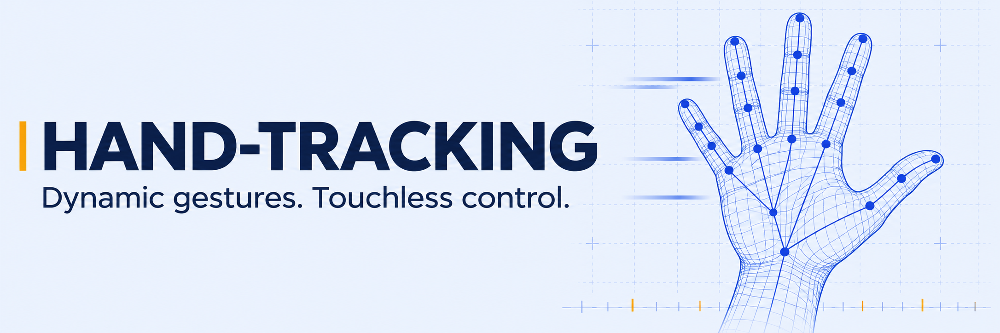
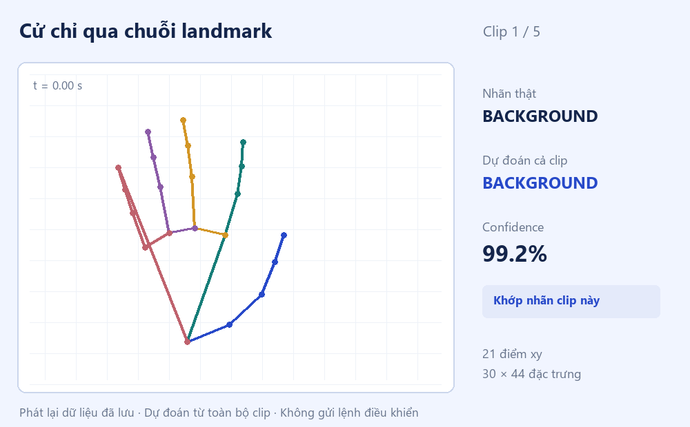
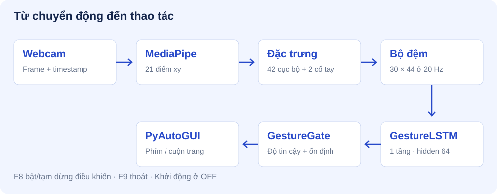
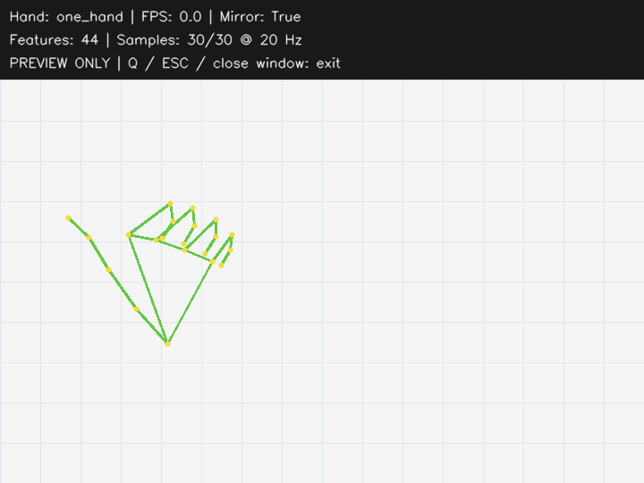
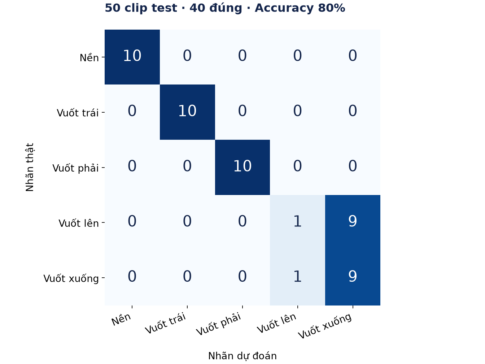
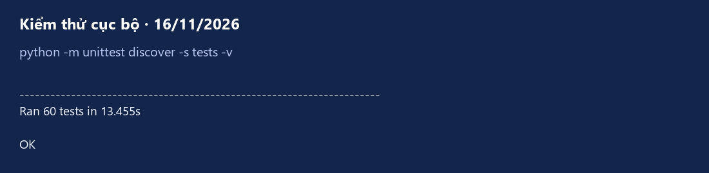

<p align="center">
  
</p>

<h1 align="center">Hand-Tracking</h1>

<p align="center">
  <strong>Nhận diện cử chỉ tay động để chuyển slide và cuộn trang bằng webcam.</strong><br>
  Đồ án chuyên ngành với MediaPipe, đặc trưng chuyển động và mô hình LSTM.
</p>

<p align="center">
  <a href="pyproject.toml"></a>
  <a href="src/hand_tracking/landmarks.py"></a>
  <a href="src/hand_tracking/model.py"></a>
  <a href="src/hand_tracking/camera.py"></a>
  <a href="notebook/hand_tracking.ipynb"></a>
  <a href="#kiem-thu"></a>
</p>

<p align="center">
  <a href="#demo">Demo</a> ·
  <a href="#tinh-nang">Tính năng</a> ·
  <a href="#bat-dau">Bắt đầu</a> ·
  <a href="#su-dung">Sử dụng</a> ·
  <a href="#du-lieu-va-huan-luyen">Huấn luyện</a> ·
  <a href="#ket-qua">Kết quả</a> ·
  <a href="#notebook">Notebook</a>
</p>

> **Lần đầu clone:** `preview` cần model landmark; `run` cần thêm checkpoint LSTM đã huấn luyện. Dữ liệu tự thu và checkpoint được giữ trên máy. Làm theo phần [Bắt đầu](#bat-dau) trước khi mở webcam.

<a id="demo"></a>
## 🎬 Xem cách dữ liệu chuyển động



GIF phát lại **21 điểm bàn tay từ năm clip test đã lưu**, kèm dự đoán của checkpoint thực nghiệm. Nhãn dự đoán được tính từ toàn bộ chuỗi `30 × 44` của từng clip. Có giữ lại ví dụ vuốt lên bị nhầm thành vuốt xuống để phản ánh kết quả hiện tại.

Đây là minh họa phát lại dữ liệu, không phải phép đo nhận diện trực tiếp hay demo gửi lệnh điều khiển. [Xem ảnh tĩnh](docs/media/landmark-demo-still.png) · [Nguồn và cách tạo hình](docs/media/README.md).

<a id="tinh-nang"></a>
## ✨ Những gì project đã làm được

- **🖐 Theo dõi bàn tay:** đọc webcam, trích 21 landmark 2D và phát hiện trường hợp mất tay hoặc có nhiều tay.
- **📐 Tạo đặc trưng theo thời gian:** 42 tọa độ cục bộ và hai tọa độ cổ tay; ghép chuỗi 30 bước ở nhịp lấy mẫu 20 Hz.
- **🧠 Phân loại năm nhãn:** nền, vuốt trái, vuốt phải, vuốt lên và vuốt xuống bằng LSTM một tầng.
- **🎛 Xác nhận rồi gửi lệnh:** lọc độ tin cậy, độ ổn định, cooldown và nền; F8 bật/tạm dừng, F9 thoát toàn cục trong chế độ nhận diện có cửa sổ.
- **📦 Thu và quản lý dữ liệu:** đếm ngược trước khi ghi, tiếp tục phiên còn thiếu, kiểm tra dữ liệu, bỏ mẫu sai vào backup và khôi phục.
- **📓 Học và thực nghiệm:** notebook đi từ công trình tham khảo đến đặc trưng, forward, huấn luyện, đánh giá và mô phỏng GestureGate.

### Công nghệ đảm nhiệm việc gì?

- **Python:** CLI, cấu hình và xử lý dữ liệu; khai báo hỗ trợ 3.11–3.12, môi trường đã kiểm tra là Python 3.11 trên Windows.
- **OpenCV + MediaPipe:** đọc ảnh, lấy timestamp, trích landmark và vẽ giao diện xem trước.
- **NumPy + PyTorch:** tạo chuỗi đặc trưng, huấn luyện và chạy mô hình LSTM.
- **pynput + PyAutoGUI:** nhận phím nóng toàn cục và gửi phím/cuộn trang sau khi xác nhận cử chỉ.
- **JupyterLab + Matplotlib:** đọc hiểu code, phát lại dữ liệu và trình bày thực nghiệm.

Các nhóm phụ thuộc được khai báo trong [pyproject.toml](pyproject.toml).

<a id="luong-xu-ly"></a>
## Luồng xử lý



Mỗi lần có cửa sổ chuỗi mới, LSTM trả về một nhãn và confidence. Khi bật điều khiển, `GestureGate` quyết định có xác nhận cử chỉ hay chưa. Chỉ cử chỉ đã xác nhận mới được chuyển thành thao tác.

<details>
<summary><strong>Thông số mặc định và cách xử lý mất tay</strong></summary>

- **Đầu vào:** `30 × 44`; 30 bước lấy mẫu ở 20 Hz, xấp xỉ 1,5 giây chuyển động.
- **Đặc trưng:** 21 điểm xy được đưa về cùng tỷ lệ ảnh, lấy cổ tay làm gốc và chuẩn hóa theo kích thước lòng bàn tay; nối thêm hai tọa độ cổ tay toàn cục.
- **Mô hình:** một tầng LSTM, hidden size 64, lấy đầu ra ở bước cuối qua Linear để có năm logits.
- **Chuỗi bị gián đoạn:** mất tay, hai tay hoặc khoảng hở tracking dài hơn 100 ms làm xóa bộ đệm. Khoảng hở ngắn được nội suy khi đã nhận đủ hai đầu mút.
- **Nhịp lấy mẫu và FPS:** 20 Hz là nhịp của chuỗi đặc trưng, không phải cam kết tốc độ webcam hay FPS xử lý.

Xem [features.py](src/hand_tracking/features.py), [model.py](src/hand_tracking/model.py) và [cấu hình mặc định](configs/default.json).

</details>

<a id="bat-dau"></a>
## 🚀 Bắt đầu trên Windows

Cần **Python 3.11**, **Git**, webcam và PowerShell. Các lệnh dưới đây chạy tại thư mục gốc `Hand-Tracking`.

### 1. Clone và tạo môi trường

```powershell
git clone https://github.com/trinhvietmyx/Hand-Tracking.git
cd Hand-Tracking

py -3.11 -m venv .venv
.\.venv\Scripts\python.exe -m pip install --upgrade pip setuptools
.\.venv\Scripts\python.exe -m pip install -c requirements-vision.lock.txt -e ".[app]"
```

`requirements-vision.lock.txt` là snapshot nhóm vision đã kiểm tra; nhóm `app` bổ sung PyTorch, PyAutoGUI, pynput và các phụ thuộc của ứng dụng. Không cần activate môi trường khi dùng đường dẫn Python đầy đủ như trên.

### 2. Tải model landmark

```powershell
Invoke-WebRequest `
  -Uri 'https://storage.googleapis.com/mediapipe-models/hand_landmarker/hand_landmarker/float16/1/hand_landmarker.task' `
  -OutFile 'assets/hand_landmarker/hand_landmarker.task'
```

Model được đặt đúng vị trí mà cấu hình mặc định sử dụng. [Nguồn và SHA-256](assets/hand_landmarker/README.md) được lưu trong tài liệu tài nguyên.

### 3. Kiểm tra và mở preview

```powershell
.\run.bat check
.\run.bat preview
```

Đưa **một bàn tay** vào khung hình và quan sát landmark cùng bộ đệm tăng đến `30/30`. Nhấn **Q**, **Esc** hoặc đóng cửa sổ để thoát. `check` chỉ đọc cấu hình, phiên bản thư viện và đường dẫn tài nguyên; không mở camera.



*Khung hình được tạo bằng hàm `draw_preview()` thật, dùng landmark đã lưu trên nền trống. Đây là ảnh render để minh họa giao diện; giá trị `FPS: 0.0` không phải kết quả đo hiệu năng webcam.*

> **Đã xem được bàn tay?** Có thể bắt đầu [thu dữ liệu và huấn luyện](#du-lieu-va-huan-luyen). Lệnh `run` sử dụng checkpoint ở `models/gesture_lstm.pt`; checkpoint này cần có sẵn và khớp cấu hình.

<a id="su-dung"></a>
## 🎛 Sử dụng và điều khiển

### Mở menu hoặc gọi lệnh trực tiếp

```powershell
# Menu tương tác
.\run.bat

# Nhận diện và điều khiển khi đã có checkpoint
.\run.bat run
```

Trong menu: **1** xem trước · **2** kiểm tra môi trường · **3** thu pilot · **4** thu tùy chỉnh · **5** kiểm tra dữ liệu · **6** chạy test · **7** nhận diện/điều khiển · **0** thoát.

### Bật, tạm dừng và thoát

- **Khởi động ở Control OFF:** có thể quan sát dự đoán trước khi bật gửi lệnh.
- **F8:** đổi ON/OFF, xóa bộ đệm và trạng thái xác nhận đang chờ.
- **F9:** yêu cầu thoát dù đang đứng ở cửa sổ khác.
- **Q / Esc / đóng cửa sổ:** thoát khi tương tác với cửa sổ ứng dụng.

F8/F9 được đăng ký toàn cục khi chạy `run` có cửa sổ. `preview` dùng Q/Esc hoặc đóng cửa sổ. Khi muốn chuyển slide hoặc cuộn trang, đưa ứng dụng đích lên trước để nhận phím/cuộn.

### Ánh xạ đang dùng trong code

- **⬅ Vuốt trái — `SWIPE_LEFT`:** gửi phím **←**, về slide trước.
- **➡ Vuốt phải — `SWIPE_RIGHT`:** gửi phím **→**, sang slide tiếp theo.
- **⬆ Vuốt lên — `SWIPE_UP`:** cuộn lên.
- **⬇ Vuốt xuống — `SWIPE_DOWN`:** cuộn xuống.
- **✋ Nền — `BACKGROUND`:** không gửi thao tác; dùng để mở khóa sau cử chỉ.

Ánh xạ được lấy từ [control.py](src/hand_tracking/control.py). PyAutoGUI giữ fail-safe mặc định: nếu cơ chế này kích hoạt, chương trình bắt ngoại lệ và dừng.

### Khi nào một lần vuốt được xác nhận?

Với [cấu hình hiện tại](configs/default.json), cử chỉ cần đồng thời đạt:

1. Confidence **từ 80%**.
2. **Ít nhất ba dự đoán mới liên tiếp** cùng nhãn.
3. Ổn định **ít nhất 150 ms**.

Sau khi xác nhận, gate khóa cho đến khi **đã qua 1 giây** và thấy **BACKGROUND đủ tin cậy ổn định ít nhất 300 ms**. Cơ chế này hạn chế lặp lệnh khi một chuyển động xuất hiện trong nhiều cửa sổ chuỗi.

### Đổi camera hoặc chạy có giới hạn

```powershell
.\run.bat preview --camera-index 1
.\run.bat preview --headless --max-frames 60
```

`--headless` bắt buộc có `--max-frames`. Cấu hình JSON được resolve theo gốc dự án; tùy chọn `--config` đặt **trước** tên lệnh:

```powershell
.\run.bat --config configs/default.json check
```

<a id="du-lieu-va-huan-luyen"></a>
## 📦 Thu dữ liệu → huấn luyện → đánh giá

### Thu theo các phiên riêng

Ví dụ dưới đây dành cho một bộ dữ liệu mới, tổng **250 clip**: 150 train, 50 validation, 50 test. `--count` là số clip mục tiêu **của từng nhãn**, gồm cả clip đã lưu trong phiên.

```powershell
.\run.bat collect --session train_01 --split train --count 30
.\run.bat collect --session val_01 --split validation --count 10
.\run.bat collect --session test_01 --split test --count 10
```

Trong cửa sổ thu: **Space → đếm ngược → thực hiện một động tác → SAVED**. `BACKGROUND` vẫn cần một tay hiện rõ, đang nghỉ hoặc chuyển động chậm. Nếu mất tay, hai tay hoặc tracking bị gián đoạn, chương trình yêu cầu `RETRY` và bỏ lượt dở.

Chạy lại cùng lệnh để tiếp tục phiên còn thiếu. Dùng các phiên khác nhau cho train/validation/test và tự xem lại động tác, nhãn trước khi huấn luyện.

```powershell
.\run.bat dataset-check --split train
.\run.bat dataset-check --split validation
.\run.bat dataset-check --split test
```

Video sạch lưu ở `data/raw/`, chuỗi NPZ ở `data/processed/`; `data/manifest.csv` liên kết clip với nhãn và `data/sessions/` giữ metadata từng phiên. Xem [hướng dẫn thu dữ liệu](docs/COLLECTION.md).

<details>
<summary><strong>Thu nhầm mẫu? Xem trước việc bỏ mẫu và khôi phục từ backup</strong></summary>

```powershell
# Chỉ xem trước, chưa chuyển file
.\run.bat dataset-remove --session train_01 --split train --label SWIPE_LEFT --last

# Chuyển mẫu đã chọn vào backup và cập nhật manifest
.\run.bat dataset-remove --session train_01 --split train --label SWIPE_LEFT --last --apply

# Thay <removal_id> bằng mã backup mà lệnh trên in ra
.\run.bat dataset-restore --backup-id <removal_id> --apply
```

Bỏ `--last` để chọn toàn bộ nhóm nhãn đó trong phiên. Đọc kết quả xem trước trước khi dùng `--apply`; chi tiết nằm trong [COLLECTION.md](docs/COLLECTION.md).

</details>

### Huấn luyện LSTM và đánh giá test

```powershell
.\run.bat train --epochs 30
.\run.bat evaluate
```

Huấn luyện dùng batch 16, Adam với learning rate `0.001` và seed 42. Sau mỗi epoch, code đo validation loss và lưu checkpoint tốt nhất tại `models/gesture_lstm.pt`. `evaluate` đọc tập test và ghi `outputs/evaluation.json` với accuracy, Macro-F1, metric từng lớp và ma trận nhầm lẫn.

Dùng validation để chọn cấu hình. Nếu đã dựa vào lỗi trên test để điều chỉnh mô hình, cần một tập kiểm tra độc lập cho lần đánh giá cuối.

<a id="ket-qua"></a>
## 📊 Kết quả thực nghiệm hiện có

Snapshot được đối chiếu ngày **16/11/2026**, lấy từ `outputs/notebook/evaluation.json` với checkpoint thực nghiệm riêng của notebook:

- **Dữ liệu:** 250 clip tự thu; chia theo phiên thành **150 / 50 / 50** cho train / validation / test.
- **Checkpoint:** chọn ở **epoch 23** trong lượt huấn luyện 30 epoch.
- **Test:** **40/50 clip đúng**, accuracy **80%**, Macro-F1 **0.7619**.



Trong tập test này, nền, vuốt trái và vuốt phải đều đúng 10/10 clip của từng lớp. Vuốt lên đúng 1/10, với chín clip bị đoán thành vuốt xuống; vuốt xuống đúng 9/10.

Đây là kết quả **phân loại clip chia theo phiên**. Chưa có đánh giá độc lập theo người mới hoặc bộ số liệu về đúng lệnh, sai lệnh và độ trễ khi điều khiển webcam liên tục. Chưa xác định được nguyên nhân cuối cùng của lỗi hai hướng dọc.

[Xem số liệu rút gọn](docs/media/evaluation-summary.json) · [Notebook thực nghiệm](notebook/hand_tracking.ipynb).

<a id="notebook"></a>
## 📓 Notebook và hướng nghiên cứu

Notebook được tổ chức theo trình tự: **các công trình liên quan → bài đọc chính → code tác giả → code đồ án → thực nghiệm → giới hạn và hướng tiếp theo**.

```powershell
.\.venv\Scripts\python.exe -m pip install -e ".[notebook]"
.\.venv\Scripts\python.exe -m ipykernel install --prefix .venv --name hand-tracking --display-name "Python (Hand-Tracking)"
.\.venv\Scripts\python.exe -m jupyterlab notebook
```

Chọn kernel **Python (Hand-Tracking)** và chạy từ trên xuống để có đủ biến/import. Có thể dùng **Run All Cells** trước buổi báo cáo; phần huấn luyện chạy 30 epoch. Notebook lưu checkpoint tại `models/notebook/gesture_lstm.pt`, kết quả tại `outputs/notebook/`, tách với đường dẫn mặc định của ứng dụng.

- [Mở notebook](notebook/hand_tracking.ipynb).
- [Lời trình bày với giảng viên hướng dẫn](notebook/speaker_notes.md).
- Bài đọc chính: [IPN HandS — Applied Sciences 2025](https://www.mdpi.com/2076-3417/15/11/6321), tham khảo hướng landmark 2D và baseline LSTM ở mục 5.

Đồ án điều chỉnh số đặc trưng, kiến trúc, lớp nhãn và dữ liệu so với bài báo; chưa tái lập benchmark LSTM gốc của IPN HandS. Sáu nguồn tham khảo cùng thông tin công bố được ghi trong notebook.

Các ô đọc PDF hoặc source tham khảo cần có thư mục `reference/` cục bộ; clone từ GitHub không kèm thư mục đó.

<a id="cau-truc"></a>
## Cấu trúc dự án

```text
Hand-Tracking/
├── configs/default.json       # Camera, đặc trưng, LSTM và ngưỡng điều khiển
├── src/hand_tracking/
│   ├── cli.py                 # Các lệnh ứng dụng
│   ├── camera.py              # Frame và timestamp
│   ├── landmarks.py           # MediaPipe Hand Landmarker
│   ├── features.py            # 44 đặc trưng và SequenceBuffer
│   ├── collection.py          # Thu clip có nhãn
│   ├── dataset.py             # Lưu/đọc video, NPZ và manifest
│   ├── dataset_cleanup.py     # Bỏ mẫu vào backup, khôi phục
│   ├── model.py               # GestureLSTM, tải checkpoint, dự đoán
│   ├── training.py            # Huấn luyện theo validation loss
│   ├── evaluation.py          # Metric và confusion matrix
│   ├── control.py             # GestureGate và thao tác máy tính
│   └── app.py                 # Vòng lặp preview / nhận diện
├── notebook/                  # Nghiên cứu, thực nghiệm, lời trình bày
├── tests/                     # Kiểm thử tự động
├── docs/media/                # Asset dùng trong README
├── assets/hand_landmarker/    # Hướng dẫn tải model landmark
├── data/                      # README, .gitkeep; dữ liệu thật lưu cục bộ
├── models/                    # README; checkpoint lưu cục bộ
├── outputs/                   # README; kết quả sinh ra lưu cục bộ
├── pyproject.toml             # Package và nhóm phụ thuộc
├── requirements-vision.lock.txt
└── run.bat                    # Menu và lệnh nhanh trên Windows
```

### Những gì được giữ ở máy

[.gitignore](.gitignore) loại `.venv`, secrets/cấu hình riêng, cache, log, file build, dữ liệu thu, checkpoint và kết quả sinh tự động. Hai thư mục **`reference/` và `reports/`** cũng được giữ cục bộ. Các hình trong `docs/media/` là asset riêng phục vụ README; không chứa video webcam gốc, khuôn mặt hoặc manifest dữ liệu.

Mã nguồn, cấu hình mặc định, hướng dẫn, notebook và `.gitkeep` được theo dõi để project có thể thiết lập lại trên máy khác.

<a id="kiem-thu"></a>
## ✅ Kiểm thử

```powershell
.\run.bat test
```

Hoặc:

```powershell
.\.venv\Scripts\python.exe -m unittest discover -s tests -v
```



**60/60 kiểm thử đạt** trong lượt chạy cục bộ ngày 16/11/2026. Ảnh trên định dạng lại phần tóm tắt stdout/stderr thật để dễ đọc. Badge test là snapshot của lượt kiểm tra này, không phải trạng thái CI.

Các kiểm thử bao phủ cấu hình/CLI, camera và tracker qua I/O giả, trích đặc trưng, sampling, thu/đọc/bỏ/khôi phục dữ liệu, đánh giá và phím điều hướng. Chúng không tự mở webcam hoặc gửi lệnh thật lên desktop.

<a id="xu-ly-su-co"></a>
## Khi cần kiểm tra lỗi

<details>
<summary><strong>No module named hand_tracking</strong></summary>

Đứng tại thư mục gốc project, dùng đúng Python của `.venv` và cài lại package:

```powershell
.\.venv\Scripts\python.exe -m pip install -e ".[app]"
.\run.bat check
```

`run.bat` cũng thêm thư mục `src` vào `PYTHONPATH` cho lượt chạy. Nếu chuyển project sang máy khác, tạo lại môi trường Python.

</details>

<details>
<summary><strong>Không tìm thấy model hoặc checkpoint không khớp</strong></summary>

- Model landmark phải nằm ở `assets/hand_landmarker/hand_landmarker.task`, hoặc đường dẫn được đặt trong cấu hình.
- Nhận diện cần checkpoint LSTM tại `models/gesture_lstm.pt`. Chạy huấn luyện khi đã có đủ train/validation, hoặc cung cấp checkpoint tương thích.
- Loader kiểm tra kiến trúc, thứ tự nhãn, phiên bản đặc trưng, độ dài chuỗi, nhịp lấy mẫu và chiều gương. Dùng cùng cấu hình với dữ liệu và checkpoint.

</details>

<details>
<summary><strong>Không mở được camera hoặc bộ đệm liên tục bị xóa</strong></summary>

Đóng ứng dụng đang dùng webcam, kiểm tra quyền camera của Windows và thử `--camera-index 1`. Giữ một tay rõ trong khung hình. Mất tay, có hai tay hoặc khoảng hở tracking dài sẽ làm bộ đệm khởi tạo lại.

</details>

<details>
<summary><strong>Notebook báo Gesture hoặc config chưa được định nghĩa</strong></summary>

Chọn đúng kernel và chạy ô chuẩn bị môi trường/import trước. Sau khi restart kernel, chạy lại các ô từ trên xuống. Nếu đang đứng trong thư mục `notebook`, lệnh mở JupyterLab là:

```powershell
..\.venv\Scripts\python.exe -m jupyterlab .
```

</details>

---

<p align="center">
  <strong>Đọc bài báo · Hiểu code · Chạy thực nghiệm · Đo kết quả</strong><br>
  <a href="docs/COLLECTION.md">Hướng dẫn thu dữ liệu</a> ·
  <a href="docs/media/README.md">Nguồn hình ảnh</a> ·
  <a href="notebook/hand_tracking.ipynb">Notebook</a>
</p>
