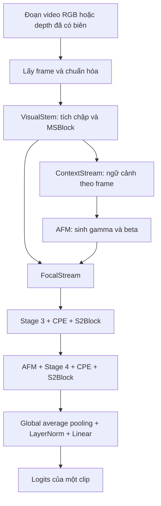
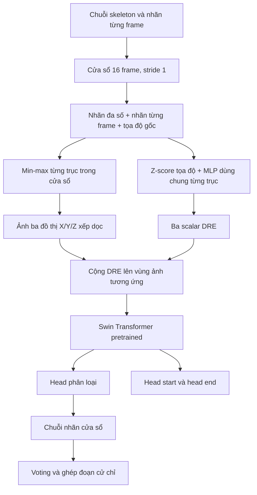
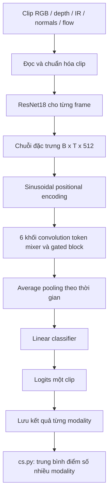
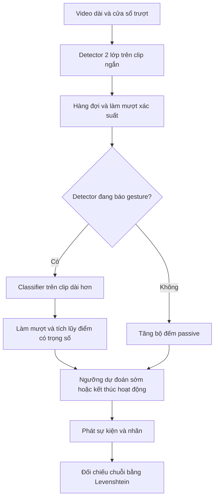

# Nghiên cứu Reference: cấu trúc và luồng xử lý của các công trình đi trước

Ngày nghiên cứu: 28/10/2026. Phạm vi: cả 6 mục trong `D:\Learn\Hutech\Do_an_chuyen_nganh\Reference`.

Đây là ghi chú đọc tài liệu và phân tích tĩnh mã nguồn. Không cài môi trường của các công trình, không chạy huấn luyện/suy luận, không sửa nguồn tham khảo, không chọn hay xây dựng kiến trúc đồ án trong phiên này. Các con số tác giả công bố không phải kết quả tái lập tại máy này.

## 1. Mức độ tài liệu thực tế

- **S2Gest:** đã đọc README, cấu hình, mô hình, đường vào dữ liệu NVGesture, tổ chức train/test và tiện ích tải trọng số. Trang Springer truy cập được phần tóm tắt; chưa truy cập toàn văn chương sách. Các mô tả chi tiết dưới đây chủ yếu có căn cứ trực tiếp từ code local.
- **SKETCH:** đã đọc phần phương pháp, hình kiến trúc, giới hạn và các phần phụ lục liên quan trong PDF chính thức 41 trang; lần theo code chuẩn bị cửa sổ, dựng ảnh, dataset, model, train, test và hậu xử lý SHREC'22.
- **GESTRO:** đã đọc PDF chính thức 14 trang, gồm phương pháp, thí nghiệm và triển khai robot. Bản nguồn local chỉ có README “Following soon.”, không có code mô hình để kiểm chứng.
- **ConvMixFormer:** đã đọc bản PDF 11 trang do tác giả công bố trên arXiv; đối chiếu với model, backbone, loader, cấu hình train/test và script hợp nhất kết quả local. Link CVF trong thư mục không truy cập trực tiếp được ở lần kiểm tra này.
- **Continuous HGR Survey:** đã lấy được toàn văn PDF 19 trang trên trang đại học của đồng tác giả và đọc các phần taxonomy, nhóm phương pháp, tiêu chí đánh giá, ví dụ benchmark và thảo luận. Local chỉ có file đường dẫn.
- **IPN HandS:** đã đọc README phát hành HandS, README IPN Hand gốc, các phần công cụ gán nhãn và đánh giá LSTM trên nội dung bài báo được lập chỉ mục; đối chiếu pipeline offline/online của repo. Chưa thấy mã công cụ annotation hoặc mã LSTM của HandS trong bản local. Trang MDPI trực tiếp bị giới hạn truy cập ở lần kiểm tra này.

Các file `Link_bai_bao.txt` ghi lại commit được tải ngày 27/10/2026. Nhận xét về code áp dụng cho bản local của các commit đó, không mặc nhiên áp dụng cho mọi phiên bản repo.

## 2. Phân biệt bài toán trước khi đọc kiến trúc

**Nhận dạng tĩnh** dự đoán từ một tư thế/khung hình. **Nhận dạng động** cần chuỗi thay đổi theo thời gian. Trong nhận dạng động còn có hai bài toán khác nhau:

- **Isolated / segmented:** đã biết đoạn bắt đầu và kết thúc cử chỉ; mô hình gán một nhãn cho clip.
- **Continuous:** đầu vào là chuỗi dài có nhiều cử chỉ, chuyển tiếp và chuyển động ngoài từ điển; hệ thống phải tìm sự kiện và nhãn của nó.

S2Gest và ConvMixFormer trong các đường train/test đã đọc là bộ phân loại clip. SKETCH có pipeline cửa sổ và ghép sự kiện liên tục. GESTRO nối nhận dạng theo cửa sổ với ứng dụng robot. HandS đóng góp dữ liệu liên tục, nhưng thí nghiệm LSTM trong bài đánh giá phân loại các khoảng cử chỉ đã biết. Repo IPN Hand còn có một pipeline liên tục hai tầng của công trình cũ.

Vì vậy, không dùng accuracy phân loại clip để kết luận một hệ thống đã giải quyết được việc phát hiện sự kiện trên camera liên tục.

## 3. S2Gest: học đặc trưng video và quét trạng thái hai chiều

Nguồn công bố: [S2Gest, ECCV 2026](https://link.springer.com/chapter/10.1007/978-3-032-37447-9_27). Phân tích chi tiết bên dưới dựa vào mã nguồn local.

### 3.1. Cấu trúc chương trình

- `main.py`: đọc tham số, thiết lập thiết bị/phân tán, nạp cấu hình và seed, tạo thư mục kết quả, logger rồi điều phối train hoặc test.
- `datasets/`: các bộ đọc NVGesture, EgoGesture, Briareo, Jester; `data_utils/` phụ trách đọc frame và chuẩn hóa.
- `models/build.py`: chọn biến thể từ cấu hình rồi dựng model.
- `models/S2Gest.py`: định nghĩa toàn bộ các khối đặc trưng và phân loại.
- `train.py`: dựng loss, model, optimizer/scheduler, dataloader, lặp train/validate và lưu checkpoint.
- `test.py`: tách đánh giá accuracy với benchmark hiệu năng.
- `hyperparameters/`: cấu hình theo dataset và modality. Các lựa chọn nano/tiny/small thay độ rộng kênh và cấu hình Mamba.

Đường đọc chính: [main.py:256](D:/Learn/Hutech/Do_an_chuyen_nganh/Reference/01_S2Gest_ECCV_2026/Source/main.py:256), [build.py:6](D:/Learn/Hutech/Do_an_chuyen_nganh/Reference/01_S2Gest_ECCV_2026/Source/models/build.py:6).

### 3.2. Dữ liệu đi qua hệ thống

Ở NVGesture, loader dùng mốc start/end có sẵn để đọc một đoạn video. Sau đó lấy số frame theo cấu hình, chuẩn hóa Z-score từng kênh và áp dụng cùng một phép biến đổi không gian trên các frame của clip. Cấu hình RGB NVGesture đang đặt 40 frame; train crop và test center-crop cho đầu vào 192 × 256.

Tensor dataset là `[T,C,H,W]`; khi đóng batch thành `[B,T,C,H,W]`, model hoán vị sang `[B,C,T,H,W]`.

### 3.3. Vai trò từng khối

1. **VisualStem và MSBlock:** trích đặc trưng bằng các nhánh tích chập/pooling rồi nối kênh. Nhiều kernel tích chập có chiều thời gian bằng 1; cấu trúc còn có pooling theo lân cận thời gian.
2. **ContextStream:** giảm không gian và pooling theo H/W, giữ chuỗi ngữ cảnh `[B,T,D]`.
3. **AFM:** lấy trung bình chuỗi ngữ cảnh theo thời gian, chiếu thành `gamma` và `beta`, điều biến feature map bằng `gamma * feature + beta`. Đây là điều biến đặc trưng bằng ngữ cảnh, không phải detector cắt bàn tay.
4. **CPE:** cộng depthwise Conv3D vào feature map để bổ sung thông tin vị trí cục bộ.
5. **S2Block:** chia feature map thành patch 2 × 2, sắp chuỗi theo patch rồi theo các frame trong patch đó. Độ dài chuỗi là `số_patch * T`, không chỉ là T.
6. **SplitScanMamba:** chia kênh làm hai nửa; một nửa đi xuôi, nửa còn lại đảo thứ tự chuỗi trước Mamba rồi đảo lại. Nối kết quả, LayerNorm, Linear và cộng residual. Hai hướng là hai module Mamba trên nửa số kênh.
7. **Kết thúc S2Block:** chiếu về kích thước patch, ghép lại feature map, depthwise Conv3D rồi cộng residual.

Các điểm kiểm chứng: [ContextStream/AFM:114](D:/Learn/Hutech/Do_an_chuyen_nganh/Reference/01_S2Gest_ECCV_2026/Source/models/S2Gest.py:114), [SplitScanMamba:157](D:/Learn/Hutech/Do_an_chuyen_nganh/Reference/01_S2Gest_ECCV_2026/Source/models/S2Gest.py:157), [S2Block:198](D:/Learn/Hutech/Do_an_chuyen_nganh/Reference/01_S2Gest_ECCV_2026/Source/models/S2Gest.py:198), [forward:358](D:/Learn/Hutech/Do_an_chuyen_nganh/Reference/01_S2Gest_ECCV_2026/Source/models/S2Gest.py:358).

### 3.4. Huấn luyện và điều cần tiếp thu

Train dùng CrossEntropy với label smoothing 0.1. Cấu hình NVGesture RGB dùng AdamW, nạp pretrain Jester và thay cấu hình theo kích thước model. Test có Top-1/Top-5, confusion matrix và benchmark riêng cho MACs, tham số, latency, throughput.

Cần học cách tách đường dữ liệu, khối xử lý không gian, khối xử lý chuỗi và bộ đo hiệu năng. Tuy nhiên, hàm `forward` trả một nhãn clip; chưa có bộ đệm camera, mô hình non-gesture, phát hiện biên hoặc điều khiển sự kiện trong đường này. Split-scan hai chiều trên clip không đồng nghĩa với một bộ suy luận streaming duy trì trạng thái qua mọi frame.

README đã đính chính FLOPs/GFLOPs thành MACs/GMACs cho phần lớn số liệu. Khi đọc lại kết quả phải giữ đúng đơn vị. Các loader có thể ánh xạ `split="val"` sang tập test chính thức, như NVGesture; cần đọc protocol cụ thể trước khi gọi đó là một tập validation độc lập.

## 4. SKETCH: biến chuỗi tọa độ thành ảnh quỹ đạo

Nguồn công bố: [Doodle to Detect, NeurIPS 2025](https://proceedings.neurips.cc/paper_files/paper/2025/hash/ccf308ecd36579d82532851419c283cd-Abstract-Conference.html). Chi tiết triển khai dưới đây được kiểm chứng bằng code SHREC'22 local.

### 4.1. Chuỗi xử lý và cách tổ chức

Đây là **ảnh đồ thị được dựng từ tọa độ**, không phải ảnh RGB bàn tay và cũng không phải một GCN chạy trên cạnh xương.

- `shrec22/prepare_window/`: đọc skeleton/annotation, tạo cửa sổ và nhãn `.npy`.
- `shrec22/draw/`: chuẩn hóa và vẽ ảnh từng cửa sổ.
- `shrec22/train/`: dataset ghép ảnh với tọa độ, model, cấu hình và train/test.
- `post_processing/shrec22/`: tái dựng các video, voting và tính metric sự kiện.
- `demo.py`: minh họa một phần bước chuẩn bị dữ liệu, không phải toàn bộ demo webcam.

### 4.2. Tiền xử lý quyết định biểu diễn

Code SHREC'22 dùng 26 khớp với ba tọa độ. Một cửa sổ có shape `[16,3,26]`; có 16 lớp cử chỉ và lớp non-gesture mang id 16. Nhãn cửa sổ là nhãn xuất hiện nhiều nhất trong 16 frame.

Train có thể tăng cường xoay 3D; cấu hình mẫu tạo ba phiên bản gồm bản gốc và hai bản tăng cường. Ảnh được dựng bằng min-max riêng từng trục trên toàn bộ frame và khớp trong cửa sổ. Mỗi khớp có màu ổn định; X/Y/Z được xếp dọc thành ảnh 384 × 384 trong cấu hình đang đọc.

Đường tọa độ đi vào MLP được Z-score theo frame và khớp cho từng trục, khác với min-max của đường vẽ ảnh. MLP dùng chung biến vector `16*26` của mỗi trục thành một scalar. Ba scalar được cộng vào ba vùng ngang của ảnh rồi mới đưa vào Swin.

Căn cứ: [prepare_window:143](D:/Learn/Hutech/Do_an_chuyen_nganh/Reference/02_SKETCH_NeurIPS_2025/Source/shrec22/prepare_window/shrec22_prepare_window.py:143), [draw:145](D:/Learn/Hutech/Do_an_chuyen_nganh/Reference/02_SKETCH_NeurIPS_2025/Source/shrec22/draw/shrec22_draw_3stack.py:145), [dataset:88](D:/Learn/Hutech/Do_an_chuyen_nganh/Reference/02_SKETCH_NeurIPS_2025/Source/shrec22/train/dataset.py:88), [model:58](D:/Learn/Hutech/Do_an_chuyen_nganh/Reference/02_SKETCH_NeurIPS_2025/Source/shrec22/train/model.py:58).

### 4.3. Huấn luyện và suy luận thực tế

Model có một head phân loại và hai head hồi quy start/end. Loss là `CE + lambda * (MSE_start + MSE_end)`, với lambda mẫu bằng 1; optimizer AdamW, lịch cosine có warmup. Train chỉ lấy cửa sổ có độ thuần nhãn vượt ngưỡng; cấu hình hiện tại là ít nhất 0.7.

Trong test, `evaluate_model` lấy đầu ra phân loại và bỏ hai đầu ra hồi quy. File dự đoán lưu các nhãn cửa sổ. Hậu xử lý chia nhãn trở lại từng sequence, thêm non-gesture ở đầu/cuối, voting bằng cửa sổ 18 rồi đóng một sự kiện khi nhãn đa số trở về non-gesture. Nhãn sự kiện được chọn bằng số phiếu tích lũy.

Do đó, cần phân biệt **nhánh hồi quy tham gia huấn luyện** với **nhánh hồi quy được dùng để dựng biên lúc test**. Đường code hiện đọc xác nhận điều thứ nhất, chưa thể hiện điều thứ hai.

### 4.4. Các chi tiết dễ hiểu nhầm

- Tên “topology-agnostic” nói về cách biểu diễn không cần đồ thị cạnh xương. Bản MLP local vẫn cố định kích thước `16*26`; không thể đưa thẳng skeleton 21 khớp vào mà không đổi cách chuẩn bị và cấu hình.
- DRE được tính từ tọa độ đã Z-score. Không nên giải thích nó như đầu vào trực tiếp là ba giá trị biên độ tuyệt đối chưa chuẩn hóa.
- Hậu xử lý đọc `preds[i:i+18]`, dùng cửa sổ về phía sau chỉ số i và bù mốc theo nửa cửa sổ. Đây là tái dựng trên chuỗi đã có; nếu triển khai trực tuyến phải tính thời điểm dữ liệu thực sự sẵn có.
- Giá trị delay trong file kết quả được xây dựng từ mốc start cộng nửa cửa sổ voting; không phải số mili giây đo trực tiếp trên webcam.
- Code có hai head biên nhưng ghép đoạn đang phụ thuộc trở về non-gesture. Không mặc nhiên tách được hai cử chỉ liền nhau khi giữa chúng không có đoạn nền được dự đoán.
- Metric `JI` trong script đánh giá là `TP/(TP+FN+FP)` ở mức sự kiện sau ghép cặp. Quy tắc ghép cặp còn kiểm tra độ dài đoạn dự đoán và mức phủ GT; không đồng nhất nó với temporal IoU của một cặp đoạn.
- Script hiện chọn checkpoint tốt nhất theo accuracy trên tập được đặt tên test. Đó là cách repo đang chạy, không tự động trở thành protocol nên sao chép cho nghiên cứu mới.

Căn cứ: [train:83](D:/Learn/Hutech/Do_an_chuyen_nganh/Reference/02_SKETCH_NeurIPS_2025/Source/shrec22/train/train.py:83), [train loss:160](D:/Learn/Hutech/Do_an_chuyen_nganh/Reference/02_SKETCH_NeurIPS_2025/Source/shrec22/train/train.py:160), [test:40](D:/Learn/Hutech/Do_an_chuyen_nganh/Reference/02_SKETCH_NeurIPS_2025/Source/shrec22/train/test.py:40), [post-processing:82](D:/Learn/Hutech/Do_an_chuyen_nganh/Reference/02_SKETCH_NeurIPS_2025/Source/post_processing/shrec22/post_processing.py:82), [evaluation:21](D:/Learn/Hutech/Do_an_chuyen_nganh/Reference/02_SKETCH_NeurIPS_2025/Source/post_processing/shrec22/matlab.py:21).

Điều tiếp thu: biểu diễn dữ liệu có thể là đóng góp chính; mô hình phân loại chỉ là một phần của pipeline liên tục. Phải lần theo file dự đoán sang hậu xử lý mới biết đầu ra thực tế là gì.

## 5. GESTRO: skeleton thân trên đến nhận dạng phục vụ robot

Theo [bài GESTRO, mục 3–6](https://link.springer.com/content/pdf/10.1007/s10846-026-02395-9.pdf):

`RGB → pose ResNet152 → chọn landmark thân trên → chuẩn hóa theo ảnh và mũi → cửa sổ 30 frame → 2 BiLSTM → attention → 11 lớp → ứng dụng robot`.

Dataset có 3.300 mẫu, 10 người, gồm lớp unknown. Thí nghiệm chia theo người: 8 train, 2 test. Mô hình công bố accuracy 98%. Robot bỏ frame đến nhanh hơn khả năng xử lý; tốc độ pose và tốc độ nhận dạng khác tốc độ camera.

Thông số đầu vào chưa thống nhất: mục 3.2 chọn 54 điểm rồi bỏ mũi; mục 4 vẫn ghi 54 × 2 = 108; bảng 3 ghi 161. Chưa có code để giải quyết khác biệt này.

Điều tiếp thu: giữ ngữ cảnh tay/cánh tay theo tác vụ; tính cả chi phí pose và thời gian tích lũy cửa sổ. Không lấy 98% làm bằng chứng cho chất lượng phát hiện sự kiện liên tục.

Trạng thái nguồn local được kiểm chứng tại [Readme.md](D:/Learn/Hutech/Do_an_chuyen_nganh/Reference/03_GESTRO_JIRS_2026/Source/Readme.md).

## 6. ConvMixFormer: đặc trưng từng frame và trộn theo thời gian bằng tích chập

Nguồn công bố: [ConvMixFormer, bản arXiv của tác giả](https://arxiv.org/abs/2411.07118). Các mô tả thực thi dưới đây căn cứ vào code local.

### 6.1. Luồng chính

### 6.2. Đọc theo module

- `main.py` chọn train/test từ cấu hình JSON.
- `datasets/NVGestures.py`, `datasets/Briareo.py` chọn sensor, đọc clip, chuẩn hóa và augmentation.
- `models/backbones/resnet.py` cung cấp ResNet18 pretrained ImageNet, kết thúc ở vector 512 chiều và điều chỉnh đầu vào cho số kênh khác nhau.
- `models/temporal.py` tách từng frame từ tensor có kênh thời gian được đóng gói, chạy backbone rồi ghép lại chuỗi `[B,T,512]`.
- `models/attention.py` triển khai các khối trộn chuỗi.
- `cs.py` là bước hợp nhất kết quả sau suy luận bằng các CSV, không phải một mô hình đa modality thống nhất trong `forward`.

Các điểm kiểm chứng: [temporal.py:13](D:/Learn/Hutech/Do_an_chuyen_nganh/Reference/04_ConvMixFormer_WACV_2025/Source/src_convmixformer/models/temporal.py:13), [attention.py:87](D:/Learn/Hutech/Do_an_chuyen_nganh/Reference/04_ConvMixFormer_WACV_2025/Source/src_convmixformer/models/attention.py:87), [cs.py:34](D:/Learn/Hutech/Do_an_chuyen_nganh/Reference/04_ConvMixFormer_WACV_2025/Source/src_convmixformer/cs.py:34).

### 6.3. Khối mang tên attention thực sự làm gì?

Trong đường code đang hoạt động, một depthwise Conv1D kernel 3 trộn các vị trí thời gian. Sau đó có phép chiếu kênh bằng Conv1D kernel 1, depthwise Conv1D, chia đôi kênh, tính `GELU(x1) * x2`, chiếu về 512 rồi dropout, cộng residual và LayerNorm.

Tên lớp là `MultiHeadAttention`, nhưng đường đang chạy không tính ma trận self-attention QKᵀ thông thường. Các tham số tên `n_head`, `d_k`, `d_v` không đủ để kết luận mô hình thực thi multi-head self-attention.

Config mẫu dùng 6 khối, CE và AdamW. Ở NVGesture, hàm đọc tạo vùng chứa 80 frame rồi dataset lấy cách hai frame thành 40; cần đọc cả loader chứ không chỉ trường `n_frames` trong JSON.

### 6.4. Khác biệt bài báo và bản code hiện có

Bài báo mô tả class token embedding kết hợp WaveMixSR. Trong `attention.py`, `cls_token` được tạo và repeat nhưng phần nối vào chuỗi đang bị comment; chưa thấy WaveMixSR được gọi trong đường `forward` này. Vì thế, ghi nhận hai luồng riêng: **kiến trúc trong bài** và **đường thực thi của bản repo local**. Không khẳng định chúng tương đương hoàn toàn.

Model trả nhãn clip, chưa có head temporal boundary hoặc cơ chế phát hiện từng sự kiện của video dài. Average pooling theo thời gian làm mất trục thời gian ở đầu ra phân loại. Tham số `nogesture` trong CLI tự nó không chứng minh đã có pipeline continuous/CTC đang hoạt động.

Điều tiếp thu: có thể giữ cấu trúc encoder theo chuỗi nhưng thay phép trộn token bằng phép toán rẻ hơn; phải kiểm tra toán tử được gọi thật, không suy kiến trúc từ tên lớp.

## 7. Continuous HGR Survey: khung đọc và đánh giá toàn hệ thống

[Bản toàn văn từ trang đồng tác giả](https://www.cs.ucf.edu/~jjl/pubs/marcoCVIU2025.pdf) tổ chức khảo sát theo benchmark, loại dữ liệu, góc nhìn, từ điển cử chỉ, phương pháp và metric.

Các luồng chính gồm: tách đoạn rồi phân loại; phân loại cửa sổ trượt; mô hình chuỗi dự đoán từng frame rồi hậu xử lý thành sự kiện. Khảo sát nhấn mạnh benchmark và metric chưa thống nhất, dữ liệu nền và chất lượng tracking ảnh hưởng khả năng dùng thực tế.

Điều tiếp thu khi đọc các bài còn lại:

- Hỏi mô hình nhận clip có biên hay tự tìm biên.
- Đọc định nghĩa đúng/sai của một sự kiện, không chỉ tên metric.
- Đọc bỏ sót, phát hiện nhầm, độ trễ và tài nguyên bên cạnh accuracy.
- Kiểm tra người dùng, bối cảnh thu và chuyển động ngoài từ điển.

Đây là khung đối chiếu nghiên cứu, không phải một mô hình mới hay repo cần chạy.

## 8. IPN HandS: cải thiện dữ liệu và tách biệt benchmark IPN Hand cũ

### 8.1. Đóng góp và mô hình đánh giá trong bài

Theo [bài IPN HandS, mục 3 và 5](https://www.mdpi.com/2076-3417/15/11/6321):

`Video → MediaPipe khởi tạo → sửa landmark/tay/ngón, nội suy hoặc copy-paste → sửa nhãn thời gian → dữ liệu tinh chỉnh`.

Thí nghiệm nhận dạng dùng một tay chính, 21 điểm 2D thành 42 đặc trưng/frame; ba LSTM một chiều, mỗi tầng 256 hidden, rồi lớp phân loại 14 cử chỉ. Các khoảng đã gán biên được chia tối đa 64 frame, stride 32 với đoạn dài; đoạn ngắn giữ nguyên. Background bị loại khỏi thí nghiệm. Vì vậy đây là đánh giá phân loại đoạn, dù dữ liệu gốc liên tục.

Điều tiếp thu: đánh giá tác động của chất lượng annotation lên khả năng học; chưa có mã LSTM hoặc công cụ annotation tương ứng trong bản local để xác nhận chi tiết thực thi.

### 8.2. Hợp đồng dữ liệu từ README phát hành

Các chi tiết dưới đây có căn cứ trực tiếp tại [README_HandS.md](D:/Learn/Hutech/Do_an_chuyen_nganh/Reference/06_IPN_HandS_Applied_Sciences_2025/Source/README_HandS.md):

- Có 200 video gốc; split là 148 video train và 52 test.
- 14 lớp cử chỉ cộng non-gesture. Lớp Grab mới và việc chỉnh temporal annotation làm taxonomy khác IPN Hand gốc.
- Frame HandS được trích từ video 640 × 480 ở 30 fps, chỉ số 1-based. Annotation interval gồm cả start và end.
- Bộ frame 320 × 240 của IPN Hand cũ đã loại frame gần trùng, nên timeline của hai bản bị lệch. Không ghép annotation mới với bộ frame cũ theo cùng số thứ tự.
- Mỗi video có JSON tra bằng tên frame, với danh sách 0, 1 hoặc 2 tay. Mỗi tay có handedness và 21 landmark theo thứ tự MediaPipe.
- x/y chuẩn hóa theo kích thước ảnh; điểm ngoài ảnh vẫn được giữ và có thể ngoài khoảng 0–1.
- z là độ sâu tương đối từ MediaPipe, **không được kiểm chứng thủ công**. Các pose landmark phụ trợ trong ground truth cũng không được sửa thủ công.
- Có ba nguồn landmark riêng: bản tinh chỉnh, dự đoán MediaPipe Holistic và dự đoán MediaPipe Hands. Không xem cả ba là ground truth cùng chất lượng.

Như vậy, tên “ground truth skeleton” không cho phép suy ra rằng toàn bộ tọa độ 3D và các điểm thân người đều đã được kiểm định.

### 8.3. Luồng continuous đang có trong repo thuộc IPN Hand gốc

`main.py` huấn luyện/kiểm thử offline bằng các backbone video 3D-CNN. `online_test.py` nạp hai model, chạy detector như công tắc của classifier, dùng queue và các trạng thái active/passive, sau đó quyết định phát dự đoán. Nó duyệt frame đã lưu trên đĩa theo thứ tự, không phải sẵn một ứng dụng webcam hoàn chỉnh.

Script `run_online_ipnTest.sh` cấu hình detector ResNetL-10 với 8 frame và 2 lớp; classifier ResNeXt-101 với 32 frame và 13 lớp. Đây là một bằng chứng rõ cho việc code benchmark cũ không phải mạng LSTM 14 lớp trong bài HandS.

Căn cứ: [load_models:41](D:/Learn/Hutech/Do_an_chuyen_nganh/Reference/06_IPN_HandS_Applied_Sciences_2025/Source/online_test.py:41), [detector/classifier:285](D:/Learn/Hutech/Do_an_chuyen_nganh/Reference/06_IPN_HandS_Applied_Sciences_2025/Source/online_test.py:285), [state và phát kết quả:359](D:/Learn/Hutech/Do_an_chuyen_nganh/Reference/06_IPN_HandS_Applied_Sciences_2025/Source/online_test.py:359), [script cấu hình](D:/Learn/Hutech/Do_an_chuyen_nganh/Reference/06_IPN_HandS_Applied_Sciences_2025/Source/tests/run_online_ipnTest.sh).

Điều tiếp thu: một hệ thống liên tục có nhiều quyết định ngoài neural network: cửa sổ, queue, ngưỡng, trạng thái hoạt động và cách phát sự kiện. Cần đọc riêng các lớp đó thay vì gộp tất cả vào accuracy của classifier.

## 9. Các nguyên lý đã rút ra để làm nền cho những lần trao đổi tiếp theo

Các điểm dưới đây là tổng hợp từ đối chiếu code và tài liệu trong phiên, không phải đề xuất kiến trúc mới cho đồ án.

### 9.1. Hợp đồng dữ liệu đi trước lựa chọn mô hình

SKETCH local nhận 26 khớp 3D; HandS dùng thứ tự 21 khớp tay và baseline đánh giá chỉ x/y; GESTRO dùng ngữ cảnh thân trên; S2Gest/ConvMixFormer nhận ảnh/video. Chúng không hoán đổi đầu vào trực tiếp.

Trước khi kế thừa một module, cần hiểu shape, đơn vị, hệ tọa độ, thứ tự khớp, cách chọn tay, frame index, fps và định nghĩa lớp nền. Nếu sai timeline, một mô hình đúng vẫn học nhãn sai.

### 9.2. Chuyển động có thể được mã hóa ở nhiều nơi

- S2Gest: giữ feature map rồi sắp chuỗi patch–thời gian cho Mamba.
- SKETCH: chuyển quỹ đạo tọa độ thành ảnh, cộng biểu diễn học được rồi dùng backbone thị giác.
- ConvMixFormer: CNN từng frame, sau đó trộn chuỗi vector bằng tích chập.
- GESTRO và baseline HandS: biểu diễn landmark theo frame rồi mô hình hồi quy chuỗi.

Không chỉ hỏi “LSTM hay Transformer”; cần hỏi phần dữ liệu nào đã bị loại, chuẩn hóa hoặc gộp trước khi vào model.

### 9.3. Phân loại và phát sự kiện là hai đầu ra khác nhau

Một clip có nhãn không tự xác định được khi nào thực thi một lệnh. Pipeline continuous còn cần cách mở/đóng đoạn, xử lý nền, chốt nhãn và xử lý các cửa sổ chồng lấp. Trong dữ liệu hiện có, phần này thấy rõ nhất ở hậu xử lý SKETCH và state machine của IPN Hand cũ.

### 9.4. Online phải được đọc theo thời điểm dữ liệu sẵn có

Một model hai chiều vẫn có thể chạy trên cửa sổ quá khứ đã thu đủ. Điều đó khác với dự đoán nhân quả ngay khi từng frame đến hoặc việc duy trì hidden state qua toàn bộ stream. Phải tính cả thời gian chờ đủ cửa sổ và look-ahead của hậu xử lý.

Độ trễ nhận phản hồi bao gồm thu dữ liệu, tiền xử lý/tracking, inference, làm mượt và chốt sự kiện. “Clips/s”, “frame/s” và “gesture event/s” là các đại lượng khác nhau.

### 9.5. Tách mô tả nghiên cứu khỏi thực thi được công bố

Các trường hợp cần nhớ: GESTRO chưa có code; SKETCH có head biên nhưng test hiện bỏ đầu ra đó; ConvMixFormer có khác biệt class token/WaveMixSR; IPN-hand chứa nhiều thế hệ công trình. Tên thư mục, tên lớp và README chưa thay thế được việc lần theo đường gọi.

### 9.6. Kết quả chỉ có ý nghĩa trong protocol của nó

Không xếp hạng chung accuracy giữa các bài có dataset, split, modality và bài toán khác nhau. Phân biệt tập validation với test chính thức, phân biệt đo trên landmark có sẵn với đo toàn bộ hệ camera → landmark → nhận dạng. Các metric cùng tên còn có thể khác quy tắc ghép sự kiện và mẫu số.

## 10. Những điểm còn mở và ranh giới kết luận

1. Chưa đọc toàn văn S2Gest do giới hạn truy cập; kiến trúc chi tiết đã phân tích từ code.
2. Chưa có source GESTRO để xác nhận kích thước input và chi tiết triển khai attention.
3. Chưa có source annotation tool/LSTM HandS trong bản local; không dùng code 3D-CNN cũ để lấp chỗ trống này.
4. Chưa xác minh bằng chạy thực nghiệm các khác biệt giữa bài báo và code SKETCH/ConvMixFormer; chúng là quan sát phân tích tĩnh.
5. Chưa tải dataset ngoài hoặc chạy trọng số để tái lập bất kỳ kết quả nào.
6. Chưa chọn công trình nền, mô hình, bộ dữ liệu hoặc luồng điều khiển cho đồ án. Ghi chú này chỉ hình thành cơ sở nghiên cứu chung.

Khi tiếp tục làm việc, dùng ghi chú này làm bản đồ đọc lại bằng chứng; không coi những phần chưa xác minh là thông số đã chốt.
